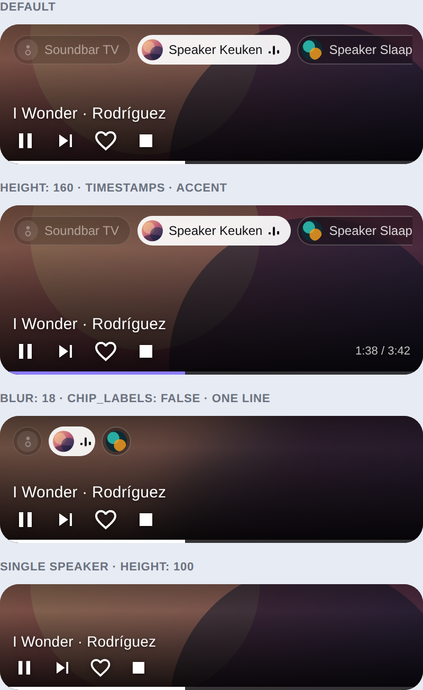

# Minimal Music Player

A very compact Lovelace media card for Home Assistant. Album art as the
background, the track on a single line, only the buttons you actually press,
and a thin progress bar along the bottom edge. Built with Music Assistant in
mind, but it works with any `media_player` entity.



- Speaker chips, so you pick which player you are controlling.
- Title and artist on **one** line (`{title} · {artist}`), scrolling when too long.
- Only the controls you list — by default play/pause, next, favourite and stop.
- No dead space: the card is 132 px high out of the box.
- Artwork fills the whole card, with an optional blur and dim.
- Thin progress bar at the very bottom, tap it to seek.
- Everything above is configurable, from the GUI editor or in YAML.

## Installation

### Manual

1. Copy `minimal-music-player.js` to `/config/www/`.
2. Settings → Dashboards → ⋮ → Resources → **Add resource**
   - URL: `/local/minimal-music-player.js`
   - Type: **JavaScript module**
3. Reload the page (hard refresh if the card does not show up).

### HACS (custom repository)

HACS → ⋮ → Custom repositories → add this repository with category
**Dashboard**, then install it and add the resource as above.

## Quick start

```yaml
type: custom:minimal-music-player
entities:
  - media_player.soundbar_tv
  - media_player.speaker_keuken_2
  - media_player.speaker_slaapkamer
```

Everything else has a sensible default. The card shows up in the card picker
as *Minimal Music Player* and has a GUI editor for the common options.

## Options

### Entities

| Option | Type | Default | Description |
| --- | --- | --- | --- |
| `entities` | list | *(required)* | Media players. A plain entity id, or `{entity: ..., name: ...}` / `{entity_id: ...}` to override the label. |

```yaml
entities:
  - media_player.soundbar_tv
  - entity: media_player.speaker_keuken_2
    name: Keuken
```

The card follows whichever player is playing. Tap a chip to control a specific
one; that choice sticks until that player stops. Long-press (right click) a
chip for the more-info dialog.

### Layout

| Option | Type | Default | Description |
| --- | --- | --- | --- |
| `height` | number | `132` | Card height in pixels. |
| `radius` | number | `18` | Corner radius. |
| `font_size` | number | `15` | Size of the text line. |
| `control_size` | number | `24` | Icon size. |

### Artwork

| Option | Type | Default | Description |
| --- | --- | --- | --- |
| `artwork` | `background` \| `none` | `background` | Use the cover as the card background. |
| `artwork_fit` | `cover` \| `contain` | `cover` | How the artwork fills the card. |
| `artwork_position` | string | `center center` | Any CSS `background-position`, e.g. `center 30%`. |
| `blur` | number | `0` | Blur radius in pixels. |
| `dim` | number | `0.35` | Black overlay, `0`–`1`. |
| `gradient` | boolean | `true` | Extra gradient behind the text for legibility. |
| `accent` | string | `#ffffff` | Colour of the progress bar and the active icons. |

### Text

| Option | Type | Default | Description |
| --- | --- | --- | --- |
| `title_format` | string | `{title} · {artist}` | The single text line. |
| `idle_format` | string | `{name}` | Shown when nothing is playing. |
| `marquee` | boolean | `true` | Scroll the line when it does not fit. |

Placeholders: `{title}`, `{artist}`, `{album}`, `{series}`, `{channel}`,
`{app}`, `{name}` (the speaker), `{state}`. A missing value drops the
separator in front of it, so `{title} · {artist}` never leaves a dangling `·`.

### Chips

| Option | Type | Default | Description |
| --- | --- | --- | --- |
| `show_chips` | `auto` \| `always` \| `never` | `auto` | `auto` hides them when there is only one speaker. |
| `chip_artwork` | boolean | `true` | Show the cover as the chip avatar. |
| `chip_labels` | boolean | `true` | Set to `false` for avatar-only chips. |

### Controls

| Option | Type | Default | Description |
| --- | --- | --- | --- |
| `controls` | list | `[play, next, favorite, stop]` | Which buttons, in this order. |
| `stop_behavior` | `stop` \| `turn_off` | `stop` | What the stop button does. |

Available buttons: `prev`, `play`, `next`, `favorite`, `stop`, `power`,
`shuffle`, `repeat`. Buttons the player does not support are dimmed.

### Progress and volume

| Option | Type | Default | Description |
| --- | --- | --- | --- |
| `show_progress` | boolean | `true` | The bar at the bottom edge. |
| `show_timestamps` | boolean | `false` | `1:16 / 4:10` next to the buttons. |
| `seek` | boolean | `true` | Tap the bar to seek (if the player supports it). |
| `show_volume` | boolean | `false` | Slim volume slider above the progress bar. |

### Behaviour

| Option | Type | Default | Description |
| --- | --- | --- | --- |
| `idle` | `dim` \| `hide` \| `show` | `dim` | What to do when nothing is playing. |
| `tap_action` | action | `more-info` | Tapping the artwork. |
| `hold_action` | action | `none` | Holding the artwork. |
| `favorite_action` | action | – | What the heart does. |
| `favorite_entity` | entity | – | Entity that reflects "is favourite" (`on` = filled heart). |

`tap_action`, `hold_action` and `favorite_action` take the standard Home
Assistant action config (`more-info`, `navigate`, `url`, `toggle`,
`call-service`, `none`).

## The heart button

Home Assistant has no generic "favourite" service, so the heart is wired up by
you. Point it at whatever your setup uses — a Music Assistant script, a shell
command, a REST command:

```yaml
favorite_action:
  action: call-service
  service: script.favorite_current_track
  data:
    entity_id: media_player.speaker_keuken_2
```

To make the heart fill in when a track *is* a favourite, give it a state to
read — for example a template sensor or an `input_boolean`:

```yaml
favorite_entity: input_boolean.current_track_favorite
```

Without `favorite_action` the heart still animates, but it only tells you it is
not configured yet. Drop `favorite` from `controls` if you do not want it.

## Recipes

Replacing a `yet-another-media-player` setup:

```yaml
type: custom:minimal-music-player
entities:
  - media_player.soundbar_tv
  - media_player.speaker_keuken_2
  - media_player.speaker_slaapkamer
height: 140
show_timestamps: true
visibility:
  - condition: or
    conditions:
      - condition: state
        entity: media_player.soundbar_tv_3
        state: playing
      - condition: state
        entity: media_player.speaker_keuken
        state: playing
      - condition: state
        entity: media_player.speaker_slaapkamer
        state: playing
  - condition: state
    entity: input_boolean.media_dashboard
    state: "on"
```

As bare as it gets — one speaker, no chips, three buttons:

```yaml
type: custom:minimal-music-player
entities:
  - media_player.speaker_keuken_2
height: 100
controls: [play, next, favorite]
control_size: 22
font_size: 14
```

Frosted look, avatar-only chips:

```yaml
type: custom:minimal-music-player
entities:
  - media_player.speaker_keuken_2
  - media_player.speaker_slaapkamer
blur: 18
dim: 0.45
chip_labels: false
accent: "#8b7cff"
```

## Notes

- The card collapses itself with `idle: hide`, which pairs well with a
  `visibility:` block if you want the row to disappear entirely.
- Playback position is extrapolated between state updates, so the bar moves
  smoothly instead of jumping once a minute.
- Animations are disabled when the system asks for reduced motion.
